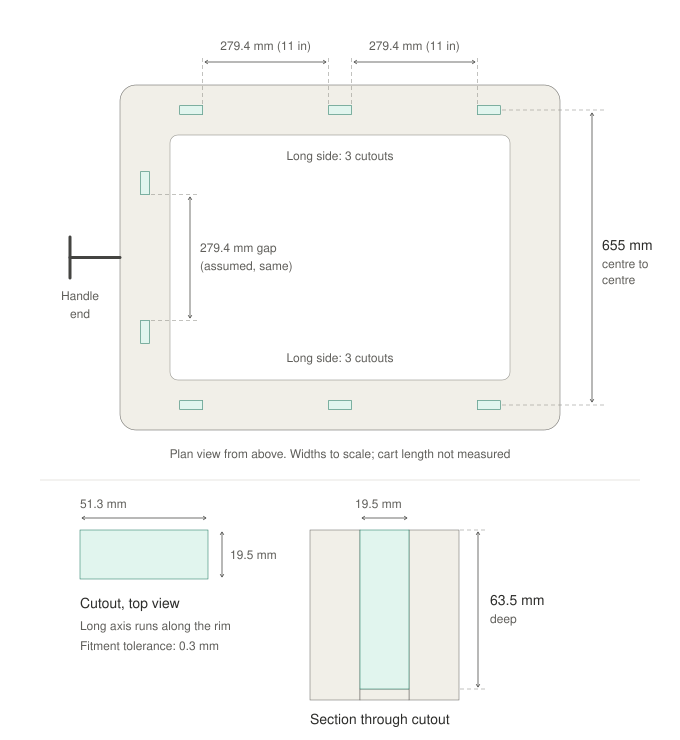
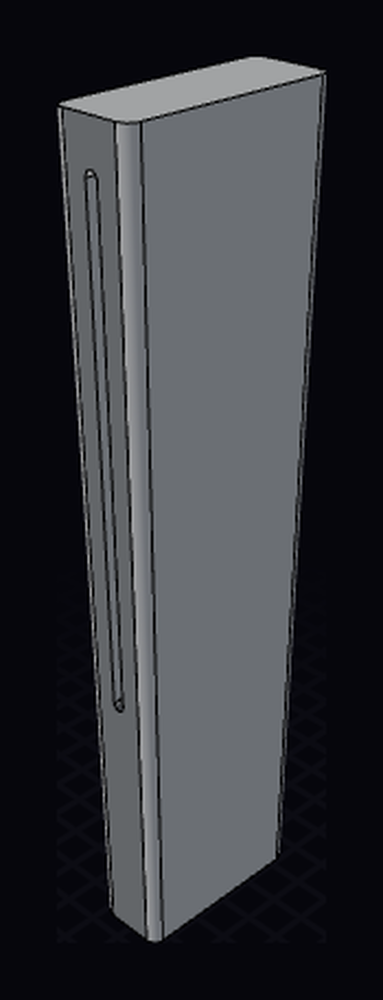

# Gorilla Cart Accessories

A brepjs CAD project containing a collection of 3D printed accessories for the [Gorilla Carts 200L Poly Dump Cart](https://www.bunnings.com.au/gorilla-carts-200l-poly-dump-cart_p0130074) (Bunnings).

The accessories plug into the cutouts in the top of the cart body.

## Cart cutout dimensions

Measured facts about the cutouts in the top rim of the cart body. All accessories are designed against these.

| Fact | Value |
| --- | --- |
| Cutout shape | Rectangle |
| Cutout size | 51.3 × 19.5 mm |
| Cutout depth | 63.5 mm |
| Fitment tolerance | 0.3 mm in total per dimension (0.15 mm per side), so a plug is 51.0 × 19.2 mm |
| Cutouts per long side | 3 on each long side (6 total) |
| Cutouts on short side nearest the handle | 2 |
| Total cutouts | 8 |
| Gap between adjacent cutouts | 11 in (279.4 mm) |
| Width across the cart (short side) | 655 mm, centre to centre between cutouts on opposite long sides |

### Cutout layout



The drawing assumes the 11 in gap is edge to edge, that the handle-end pair uses the same gap, and that the long axis of each cutout runs along the rim.

These facts live in code in [src/cart.ts](src/cart.ts), which every accessory imports.

## Accessories

### Machete sleeve



A bar that drops into a cutout and stands up above the rim. A 3 mm slot runs right through the upper part, open on both narrow faces, for the machete blade to pass through. Source: [src/machete-sleeve.brep.ts](src/machete-sleeve.brep.ts).

| | |
|---|---|
| Bar | 19.2 (X) × 51.0 (Y) × 193.2 (Z) mm, the cutout section less the fit tolerance |
| Corners | 3 mm fillet on the four upright edges; top and bottom faces flat |
| Insert | Bottom 63.5 mm sits in the cutout |
| Slot | 3 mm wide stadium, 110 mm between end centres (113 mm overall), through along Y |
| Slot position | Centred in X/Y and in the 129.7 mm above the rim: z 71.85 to 185.05 |
| Walls | 8.1 mm either side of the slot, 8.35 mm of solid above and below it |

The overall height is 63.5 + 110 + 20 − 0.3. The 0.3 mm fit tolerance is also taken off the height, as in the original design, although no fit depends on it there.

Verified against the OCCT kernel: valid single solid, manifold, 14 faces, bounding box 19.2 × 51 × 193.2. Measured volume 170498.34 mm³ matches the analytic figure. Its centre of mass sits at z = 93.40, as expected with the slot at z = 128.35. Not yet printed or test-fitted.

## Toolchain

Modelled in [brepjs](https://github.com/andymai/brepjs), code-first B-rep CAD in TypeScript, with OpenCascade compiled to WebAssembly as the kernel. Requires Node 24+ (`brew install node`).

```bash
make install
```

Each accessory is a `src/<name>.brep.ts` module that default-exports a zero-arg function returning the shape, with its dimensions in a `params` block at the top and its declared intent in an `expected` block at the bottom.

```bash
make            # list the targets and parts
make verify     # kernel validity + assert declared dimensions
make render     # multi-view PNGs into out/<name>/shots, refresh media/<name>.png
make export     # STEP + STL into out/<name>/
make all        # verify, render, export
make preview PART=machete-sleeve   # live viewer, re-evaluates on save
make clean      # drop out/
```

Targets act on every part, or on one with `PART=<name>`. `verify` exits non-zero unless each part is a valid solid and matches its `expected` block, and `export` runs the same validity gate first.
