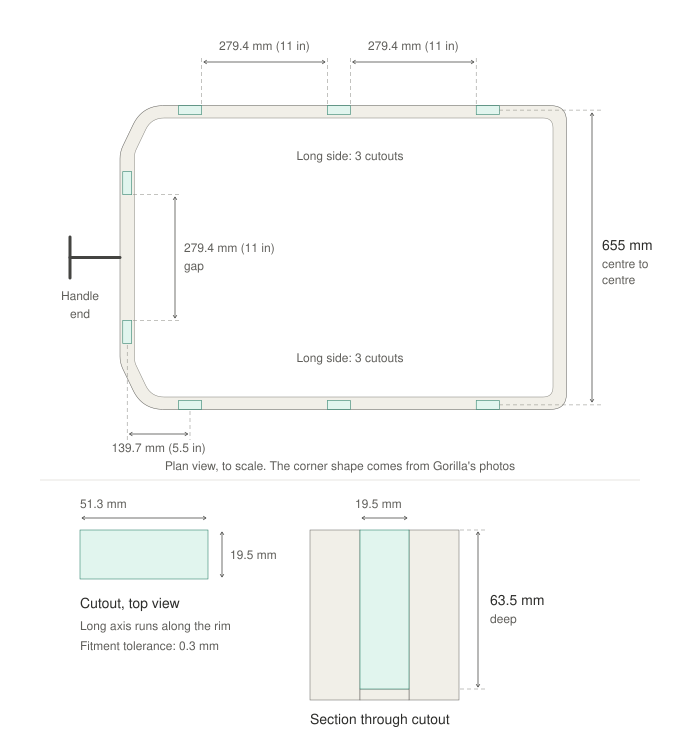
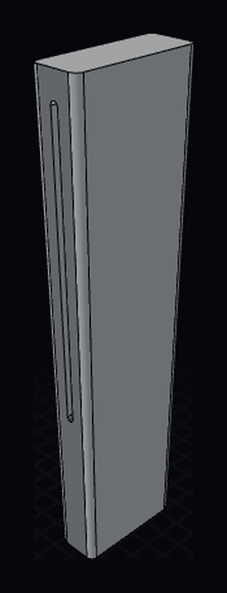
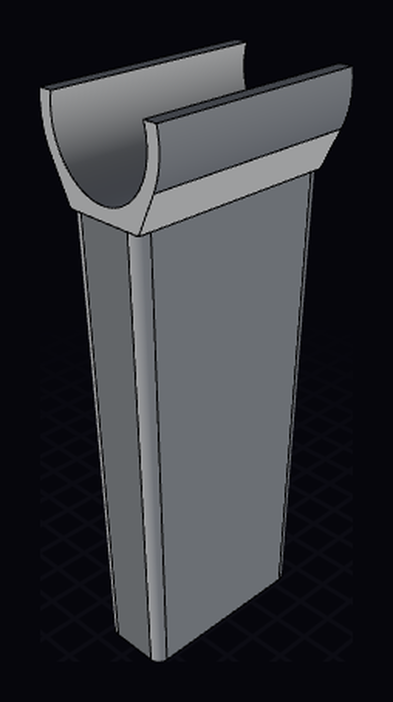
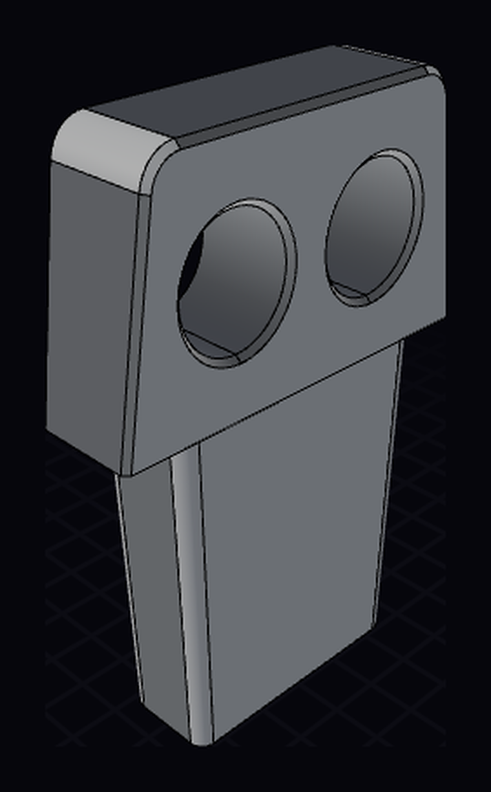
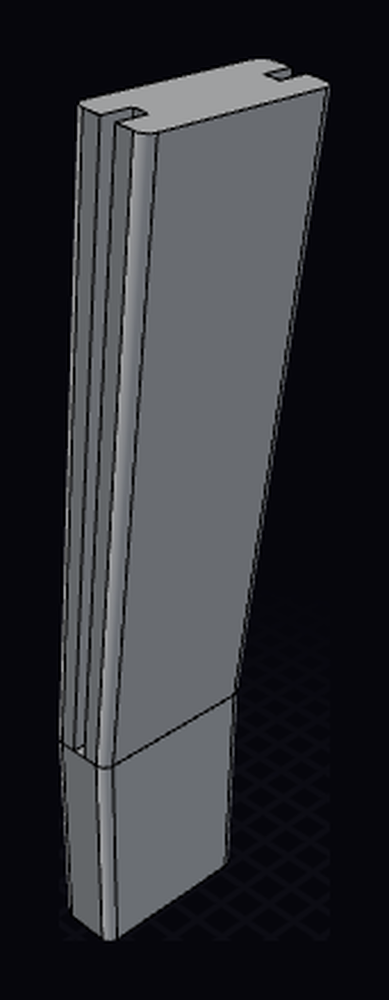
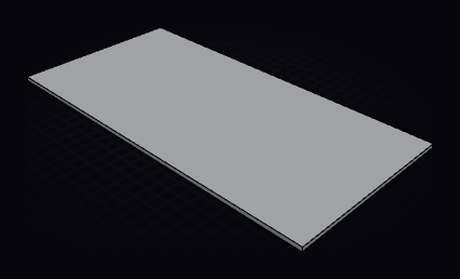
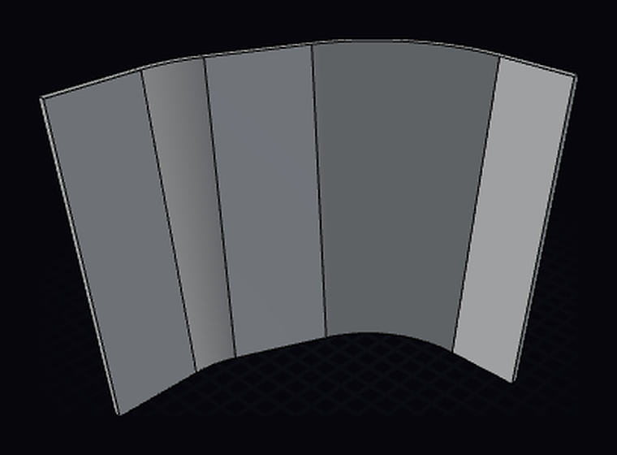

# Gorilla Cart Accessories

A brepjs CAD project containing a collection of 3D printed accessories for the [Gorilla Cart 200L Poly Dump Cart](https://gorillacarts.com.au/collections/poly-carts/products/gcg7-au).

The accessories plug into the cutouts in the top of the cart body.

## Cart cutout dimensions

Measured facts about the cutouts in the top rim of the cart body. All accessories are designed against these.

| Fact | Value |
| --- | --- |
| Cutout shape | Rectangle |
| Cutout size | 51.3 × 19.5 mm |
| Cutout depth | 63.5 mm (2.5 in) |
| Fitment tolerance | 0.3 mm in total per dimension (0.15 mm per side), so a plug is 51.0 × 19.2 mm |
| Cutouts per long side | 3 on each long side (6 total) |
| Cutouts on short side nearest the handle | 2 |
| Total cutouts | 8 |
| Gap between adjacent cutouts along a side | 11 in (279.4 mm) edge to edge, so 330.7 mm centre to centre |
| Width across the cart (short side) | 656 mm, centre to centre between cutouts on opposite long sides |
| Gap between the handle-end cutouts | 11 in (279.4 mm) edge to edge, the same as along the sides |
| Handle-end cutouts along the cart | 5.5 in (139.7 mm) from the nearest long-side cutouts, centre to centre (measured 139.65 mm) |
| Rim corners at the handle end | A round, a flat about 64.5° from the long side, and a second round (from photos) |

### Cutout layout



The long axis of each cutout runs along the rim, which the photos below confirm.

These facts live in code in [src/cart.ts](src/cart.ts), which every accessory imports.

### Derived from product photos

The rows marked "from photos" weren't measured on the cart. They come from three of Gorilla's own product photos that show the rim from above:

- [GCG-7 Image 12](https://gorillamade.com/wp-content/uploads/2019/03/GCG-7-Image_12.jpg): an overhead shot of the tub at 2000 × 2000 px, from the gallery on the [GCG-7 listing](https://gorillamade.com/product/gcg-7/)
- the top-down view in the [GCG-7 capacity and dimensions infographic](https://gorillamade.com/wp-content/uploads/2019/03/GCG-7_Infographic_CapacityDimensions_576px_UPDATED-DIMS-2025-10-03.jpg), a smaller copy of the same shot
- the overhead tub shot on the [Gorilla Carts ANZ product page](https://gorillacarts.com.au/cdn/shop/products/ScreenShot2019-04-02at12.06.00pm.png), taken from a different angle

Method: in each photo, I picked out the centres of all the cutout openings, then corrected for the camera's perspective. The six long-side cutouts were the reference points, at 655 mm across (the measurement at the time, since refined to 656 mm) and 330.7 mm pitch. That correction fits the long-side cutouts to within 1–3 px, then places the other features on the rim:

| Result | Image 12 | Infographic | ANZ photo | Model |
| --- | --- | --- | --- | --- |
| Handle-end cutouts across, from the centreline | ±163.4 / 163.5 mm | ±163.3 mm | ±163.1 / 163.8 mm | ±165.35 mm (measured) |
| Handle-end cutouts along, toward the handle | 135.7 mm | 135.3 mm | 137.5 mm | 139.7 mm (measured) |

Measured on the cart, the handle-end gap is the same 11 in as the sides, which puts those cutouts at ±165.35 mm. Measured along the cart, they sit 5.5 in (139.65 mm on the tape) from the nearest long-side cutouts. The photos placed them about 2 mm too close to the centreline and about 3 mm too close to the side cutouts: they underestimate distances beyond the reference cutouts by 1–2%. The corner shape is kept relative to the handle-end cutouts, so it moves with them.

In Image 12, the tub's outline against the white background measures 672 mm across, constant along the whole length. It runs 979 mm from the far end to the outer edge of the handle-end rim. The [GCG-7 listing](https://gorillamade.com/product/gcg-7/) gives the bed as 39.5 × 27 in (1003 × 686 mm):

- **Proportions:** the photo's length to width (1.457) matches the listing's (1.463) to within 0.4%.
- **Overall size:** the photo comes out about 2% smaller in both directions.

Scaling everything up to match the listing would put the long-side cutouts 669 mm apart instead of the 656 mm measured on the cart. The listing more likely rounds the figures or measures over the cutout housings, which bulge slightly past the rim. A 279.4 mm centre-to-centre pitch would make the tub only about 840 mm long, so the 11 in is an edge-to-edge gap.

The corner shape came from tracing the inside edge of the rim around both handle-end corners in Image 12 and the infographic. All four traces agree:

- a straight flat at 64.1–64.7° to the long side, straight to within 0.25–0.4 mm, with its ends within 2 mm across the traces
- a round into the end rim of 35–60 mm radius. This round turns only 25°, so the radius changes the path by under 1 mm.
- a round into the side rim of 40–57 mm radius

The cutouts sit about 17 mm outside that inside edge, roughly in the middle of the rim.

Expect a few millimetres of error in anything derived this way. Gorilla's US listing is the same GCG-7 tub as the AU 200L cart, but if your cart differs, measure it and update [src/cart.ts](src/cart.ts).

## Accessories

Every accessory is built on the same key: a 19.2 × 51.0 mm bar with 3 mm fillets on its four upright edges, whose bottom 63.5 mm drops into a cutout ([src/key.ts](src/key.ts)). The accessory is whatever stands above the rim.

### Machete sleeve



A bar that drops into a cutout and stands up above the rim. A 3 mm slot runs right through the upper part, open on both narrow faces, for the machete blade to pass through. Source: [src/machete-sleeve.brep.ts](src/machete-sleeve.brep.ts).

| | |
|---|---|
| Bar | 19.2 (X) × 51.0 (Y) × 193.2 (Z) mm, the cutout section less the fit tolerance |
| Corners | 3 mm fillet on the four upright edges; top and bottom faces flat |
| Insert | Bottom 63.5 mm sits in the cutout |
| Slot | 3 mm wide stadium, 110 mm between end centres (113 mm overall), through along Y |
| Slot position | Centred in X/Y and in the 129.7 mm above the rim: z 71.85 to 185.05 |
| Walls | 8.1 mm either side of the slot, 8.35 mm of solid above and below it |

The overall height is 63.5 + 110 + 20 − 0.3. The 0.3 mm fit tolerance is also taken off the height, as in the original design, although no fit depends on it there.

### Pole tool holder



The key with a U-shaped clip on its top face, for a 25.3 mm tool pole. The pole lies along the rim and snaps in through an opening narrower than the bore. Source: [src/pole-holder.brep.ts](src/pole-holder.brep.ts).

| | |
|---|---|
| Bar | 19.2 × 51.0 × 113.2 mm (63.5 insert + 50 above the rim − 0.3) |
| Clip profile | Convex hull of the bar's top edge and a 31.6 mm circle, cut flat 4 mm above the circle centre; extruded 51 mm along Y |
| Side lines | From the bar's top corners (±9.6) to tangent points at (±14.02, 8.52) above the bar |
| Bore | 25.6 mm (25.3 + 0.3) along Y, centre 15.8 mm above the bar top (z = 129.0) |
| Wall | 3 mm around the bore and under it |
| Opening | 24.32 mm, 1.28 mm narrower than the bore; 3.13 mm flat lip either side |
| Overall | 31.6 (X) × 51.0 (Y) × 133.0 (Z) mm |

The bar is 50 mm above the rim, as the original file's comment intends, rather than the 193.2 mm machete bar the file actually used. Change `standHeight` to alter it; the clip always sits on the bar's top face.

The clip is a plain extrusion, so its four bottom corners are square where they meet the bar's 3 mm rounded corners. That leaves a slight overhang of up to 1.2 mm at each corner. The original's hull blended these corners into a small twist near the base. A 3 mm fillet doesn't reproduce that here: OCCT carries it up the outer arc to the top lips.

### Tie-down block



A strap point for holding down an oversize load such as branches. The key drops into a cutout. The head on top rests on the rim either side of the cutout and has two holes through it, across the rim, for a strap, rope or hook. Fit one per cutout, as many as you need. Source: [src/tie-down-block.brep.ts](src/tie-down-block.brep.ts).

| | |
|---|---|
| Insert | 19.2 × 51.0 mm key, bottom 63.5 mm into the cutout |
| Head | Trapezoid standing on the rim: 72 mm along the rim at the base, 56 mm at the top, 40 mm high; top corners rounded at 6 mm |
| Shoulders | 10.5 mm of the head's base overhangs the cutout at each end and rests on the rim |
| Thickness | 19.2 mm across the rim, flush with the key on both faces |
| Holes | Two Ø20 mm through the head across the rim, 28 mm apart, centred 20 mm above the rim |
| Material around the holes | 8 mm between them, 7.7 mm to each sloping end (measured square to the slope), 10 mm above and 10 mm below to the rim |
| Edges | 1 mm chamfer on every edge of both broad faces above the rim, hole mouths included, so straps don't wear on a sharp edge |
| Overall | 19.2 (X) × 72 (Y) × 103.5 (Z) mm; head top 40 mm above the rim |

Print it lying on one broad face. Both faces are flat, so the holes print upright and nothing needs support. Lying down, the layers also run the length of the key, which is stronger when a strap pulls sideways on the head.

The head is flush with the key across the rim, so it doesn't overhang the rim's inner or outer edge. It's held in by friction fit alone. Pinning or bolting it would mean drilling the cart, but in use that isn't needed: run the strap through one hole and down to the cart to pull the block into its cutout, and through the other to tie down the load.

### Side extension posts



Eight identical posts, one per cutout, that raise the bucket walls to carry more than 200L. Each post stands 150 mm above the rim, leaning 6° outward. A groove down each face that points along the rim takes the edge of a side panel. The panel drops in from the top and spans to the next post. Source: [src/side-extension.brep.ts](src/side-extension.brep.ts).

| | |
|---|---|
| Insert | 19.2 × 51.0 mm key, bottom 63.5 mm straight down into the cutout |
| Post | Same section, 150 mm above the rim measured along its axis |
| Lean | 6° outward (toward +X), pivoting about the rim line; trimmed flat where it meets the insert |
| Grooves | 4 mm wide × 8 mm deep, centred on both ±Y faces, open at the top, floor at rim height |
| Material left | 7.6 mm either side of each groove, 35 mm core between the groove floors |
| Overall | 34.88 (X) × 51.0 (Y) × 213.7 (Z) mm; top 150.2 mm above the rim |

Fit each post with its lean pointing out of the cart. All posts on a side lean the same way, so the panel between two of them lies flat in a plane leaning 6° out.

Two side panels fill each long side, one fills the handle end, and a corner panel closes each handle-end corner. The end away from the handle stays open.

The insert takes no height off for fit tolerance, unlike the machete sleeve.

### Side panels



Flat plates that slide down into the grooves of two neighbouring posts on the same side. You need five: two on each long side and one across the handle end. Source: [src/side-panel.brep.ts](src/side-panel.brep.ts).

| | |
|---|---|
| Size | 295.4 (length) × 150 (height) × 3.7 (thickness) mm |
| Thickness | 4 mm groove less the 0.3 mm fit tolerance |
| Length | 295.7 mm groove floor to groove floor (330.7 pitch − 2 × 17.5), less 0.3 mm, so 0.15 mm clear at each end |
| Height | Matches the posts, 150 mm above the rim |

Print flat. At 295.4 mm long the panel needs a print bed at least 296 mm in one direction, so it won't fit a 256 mm bed.

### Corner panels



Closes each handle-end corner, from the long-side post nearest the handle to the handle-end post on that side. Between its legs it follows the rim's own corner: a round, a flat and a second round. The handle-end post sits nearer the corner than the long-side post does, so the corner isn't symmetric. The left and right corners take mirror-image parts. Sources: [src/corner-panel.ts](src/corner-panel.ts) for the shape, with [src/corner-panel-left.brep.ts](src/corner-panel-left.brep.ts) and [src/corner-panel-right.brep.ts](src/corner-panel-right.brep.ts) as the parts. Left and right are as you stand at the handle end facing the tub.

| | |
|---|---|
| Long-side leg | 122.05 mm from the corner to its end (139.7 − 17.5 − 0.15) |
| Handle-end leg | 145.0 mm from the corner to its end (162.65 − 17.5 − 0.15) |
| Flat | Meets the long-side line 43 mm from the corner and the handle-end line 90 mm from it, about 64.5° to the long side |
| Rounds | 63 mm radius into the long side and 51 mm into the handle end, on the centreline at the bottom; each grows by 15.7 mm at the top |
| Lean | Legs and flat all lean 6° outward, so the rounds are slices of cones |
| Section | 3.7 mm thick, 150 mm up the slope |
| Ends | Square to their legs and the same length top to bottom; 0.15 mm clear of each groove floor |
| Overall | 139.6 × 162.5 × 149.2 mm, printed standing on its bottom edge |

The corner's path is the inside edge of the rim moved 17 mm outward, onto the line through the cutouts. So the panel's bottom edge sits on the rim all the way round the corner.

The corner panel prints as modelled, standing up. The 6° lean is the only overhang. Use a brim, since it's a tall thin wall.

The legs lean in different directions, so the panel can't slide straight down into posts that are already fitted: at 6° the ends would have to travel 15.7 mm sideways, almost twice the 8 mm groove depth. Instead, fit it into the two posts' grooves first, then lower the posts and the panel into the cutouts together.

### Capacity

With the far end closed straight across between the two farthest long-side posts, the posts and panels hold about 80 litres above the rim. That's 80.3 L to the panels' inside faces, or 81.1 L to their mid-planes, and takes the cart to about 280 L. At the rim, the panel outline is 801.1 × 656 mm between centre lines. With the 6° lean it grows to about 832 × 687 mm at the top, 149.2 mm higher.

## Toolchain

Modelled in [brepjs](https://github.com/andymai/brepjs), code-first B-rep CAD in TypeScript, with OpenCascade compiled to WebAssembly as the kernel. Requires Node 24+ (`brew install node`).

```bash
make install
```

Each accessory is a `src/<name>.brep.ts` module that default-exports a zero-arg function returning the shape, with its dimensions in a `params` block at the top and its declared intent in an `expected` block at the bottom. Shared code lives alongside: [src/cart.ts](src/cart.ts) for the cutout measurements, [src/key.ts](src/key.ts) for the bar, [src/corner-panel.ts](src/corner-panel.ts) for the corner panel shape both corner parts share, and [src/solid.ts](src/solid.ts) for boolean result handling.

```bash
make            # list the targets and parts
make verify     # kernel validity + assert declared dimensions
make render     # multi-view PNGs into out/<name>/shots, refresh media/<name>.png
make export     # STEP + STL into out/<name>/
make all        # verify, render, export
make preview PART=machete-sleeve   # live viewer, re-evaluates on save
make clean      # drop out/
```

Targets act on every part, or on one with `PART=<name>`. `verify` exits non-zero unless each part is a valid solid and matches its `expected` block, and `export` runs the same validity gate first.
