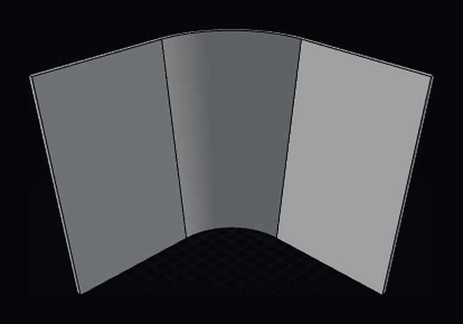

# Gorilla Cart Accessories

A brepjs CAD project containing a collection of 3D printed accessories for the [Gorilla Cart 200L Poly Dump Cart](https://www.bunnings.com.au/gorilla-carts-200l-poly-dump-cart_p0130074) (Bunnings).

The accessories plug into the cutouts in the top of the cart body.

## Cart cutout dimensions

Measured facts about the cutouts in the top rim of the cart body. All accessories are designed against these.

| Fact | Value |
| --- | --- |
| Cutout shape | Rectangle |
| Cutout size | 51.3 × 19.5 mm |
| Cutout depth | 63.5 mm |
| Fitment tolerance | 0.3 mm in total per dimension (0.15 mm per side), so a plug is 51.0 × 19.2 mm |
| Cutouts per long side | 3 on each long side (6 total) |
| Cutouts on short side nearest the handle | 2 |
| Total cutouts | 8 |
| Gap between adjacent cutouts | 11 in (279.4 mm) |
| Width across the cart (short side) | 655 mm, centre to centre between cutouts on opposite long sides |

### Cutout layout


The drawing assumes the 11 in gap is edge to edge, that the handle-end pair uses the same gap, and that the long axis of each cutout runs along the rim.

These facts live in code in [src/cart.ts](src/cart.ts), which every accessory imports.

## Accessories

Every accessory is built on the same key: a 19.2 × 51.0 mm bar with 3 mm fillets on its four upright edges, whose bottom 63.5 mm drops into a cutout ([src/key.ts](src/key.ts)). The accessory is whatever stands above the rim.

### Machete sleeve


A bar that drops into a cutout and stands up above the rim. A 3 mm slot runs right through the upper part, open on both narrow faces, for the machete blade to pass through. Source: [src/machete-sleeve.brep.ts](src/machete-sleeve.brep.ts).

| | |
|---|---|
| Bar | 19.2 (X) × 51.0 (Y) × 193.2 (Z) mm, the cutout section less the fit tolerance |
| Corners | 3 mm fillet on the four upright edges; top and bottom faces flat |
| Insert | Bottom 63.5 mm sits in the cutout |
| Slot | 3 mm wide stadium, 110 mm between end centres (113 mm overall), through along Y |
| Slot position | Centred in X/Y and in the 129.7 mm above the rim: z 71.85 to 185.05 |
| Walls | 8.1 mm either side of the slot, 8.35 mm of solid above and below it |

The overall height is 63.5 + 110 + 20 − 0.3. The 0.3 mm fit tolerance is also taken off the height, as in the original design, although no fit depends on it there.

Verified against the OCCT kernel: valid single solid, manifold, 14 faces, bounding box 19.2 × 51 × 193.2. Measured volume 170498.34 mm³ matches the analytic figure. Its centre of mass sits at z = 93.40, as expected with the slot at z = 128.35. Not yet printed or test-fitted.

### Pole tool holder


The key with a U-shaped clip on its top face, for a 25.3 mm tool pole. The pole lies along the rim and snaps in through an opening narrower than the bore. Source: [src/pole-holder.brep.ts](src/pole-holder.brep.ts).

| | |
|---|---|
| Bar | 19.2 × 51.0 × 113.2 mm (63.5 insert + 50 above the rim − 0.3) |
| Clip profile | Convex hull of the bar's top edge and a 31.6 mm circle, cut flat 4 mm above the circle centre; extruded 51 mm along Y |
| Side lines | From the bar's top corners (±9.6) to tangent points at (±14.02, 8.52) above the bar |
| Bore | 25.6 mm (25.3 + 0.3) along Y, centre 15.8 mm above the bar top (z = 129.0) |
| Wall | 3 mm around the bore and under it |
| Opening | 24.32 mm, 1.28 mm narrower than the bore; 3.13 mm flat lip either side |
| Overall | 31.6 (X) × 51.0 (Y) × 133.0 (Z) mm |

The bar is 50 mm above the rim, as the original file's comment intends, rather than the 193.2 mm machete bar the file actually used. Change `standHeight` to alter it; the clip always sits on the bar's top face.

The clip is a plain extrusion, so its four bottom corners are square where they meet the bar's 3 mm rounded corners. That leaves a slight overhang of up to 1.2 mm at each corner. The original's hull blended these corners into a small twist near the base. A 3 mm fillet doesn't reproduce that here: OCCT carries it up the outer arc to the top lips.

Verified against the OCCT kernel: valid single solid, manifold, 23 faces, bounding box 31.6 × 51 × 133. Measured volume 119653.92 mm³ matches the analytic figure. Not yet printed or test-fitted.

### Side extension posts


Eight identical posts, one per cutout, that raise the bucket walls to carry more than 200L. Each post stands 150 mm above the rim, leaning 6° outward. A groove down each face that points along the rim takes the edge of a side panel. The panel drops in from the top and spans to the next post. Source: [src/side-extension.brep.ts](src/side-extension.brep.ts).

| | |
|---|---|
| Insert | 19.2 × 51.0 mm key, bottom 63.5 mm straight down into the cutout |
| Post | Same section, 150 mm above the rim measured along its axis |
| Lean | 6° outward (toward +X), pivoting about the rim line; trimmed flat where it meets the insert |
| Grooves | 4 mm wide × 8 mm deep, centred on both ±Y faces, open at the top, floor at rim height |
| Material left | 7.6 mm either side of each groove, 35 mm core between the groove floors |
| Overall | 34.88 (X) × 51.0 (Y) × 213.7 (Z) mm; top 150.2 mm above the rim |

Fit each post with its lean pointing out of the cart. All posts on a side lean the same way, so the panel between two of them lies flat in a plane leaning 6° out.

Panels only span posts on the same side: two panels on each long side and one across the handle end, five in all. Corner panels close the two handle-end corners; the end away from the handle stays open. If the 11 in gap is edge to edge, it is 295.4 mm between groove floors. Panels should be cut shorter than that and thinner than 4 mm for clearance.

The insert takes no height off for fit tolerance, unlike the machete sleeve.

Verified against the OCCT kernel: valid single solid, manifold, 30 faces, bounding box 34.88 × 51 × 213.7. Measured volume 197809.77 mm³ matches the analytic figure, and the lean shows in the bounds: the top outer corner reaches x = 25.23. Not yet printed or test-fitted.

### Side panels


Flat plates that slide down into the grooves of two neighbouring posts on the same side. You need five: two on each long side and one across the handle end. Source: [src/side-panel.brep.ts](src/side-panel.brep.ts).

| | |
|---|---|
| Size | 295.4 (length) × 150 (height) × 3.7 (thickness) mm |
| Thickness | 4 mm groove less the 0.3 mm fit tolerance |
| Length | 295.7 mm groove floor to groove floor (330.7 pitch − 2 × 17.5), less 0.3 mm, so 0.15 mm clear at each end |
| Height | Matches the posts, 150 mm above the rim |

Print flat. At 295.4 mm long the panel needs a print bed at least 296 mm in one direction, so it won't fit a 256 mm bed.

Verified: valid solid, 295.4 × 150 × 3.7, volume 163947 mm³.

### Corner panels



Closes each handle-end corner, from the long-side post nearest the handle to the handle-end post on that side. The two legs meet in a 50 mm radius bend instead of a sharp corner. Source: [src/corner-panel.brep.ts](src/corner-panel.brep.ts).

| | |
|---|---|
| Legs | 144.5 mm from the corner to each end, 3.7 mm thick, 150 mm up the slope |
| Bend | 50 mm radius on the centreline at the bottom, growing to 65.68 at the top |
| Lean | Each leg leans 6° outward to match its posts' grooves, so the bend is a slice of a cone |
| Ends | Square to their legs and the same length top to bottom; 0.15 mm clear of each groove floor |
| Overall | 162.0 × 162.0 × 149.2 mm, printed standing on its bottom edge |

The corner panel prints as modelled, standing up. The 6° lean is the only overhang. Use a brim, since it's a tall thin wall.

The two legs lean in different directions, so the panel can't slide straight down into posts that are already fitted: at 6° the ends would have to travel 15.7 mm sideways, almost twice the 8 mm groove depth. Instead, fit it into the two posts' grooves first, then lower the posts and the panel into the cutouts together.

**The corner layout is not measured.** The handle-end leg comes from the 655 mm span and the assumed handle-end gap. The long-side leg is a placeholder set equal to it, which makes the corner square, so one part fits both corners. Measure the distance along the cart from the handle-end cutouts' centreline to the centre of the nearest long-side cutout, and set `corner.along` in [src/cart.ts](src/cart.ts). If it differs from 162.15, the two corners need mirrored parts.

Verified: valid single solid, manifold, 10 faces, bounding box 162.0 × 162.0 × 149.2. Measured volume 155319.13 mm³ matches the analytic figure.

## Toolchain

Modelled in [brepjs](https://github.com/andymai/brepjs), code-first B-rep CAD in TypeScript, with OpenCascade compiled to WebAssembly as the kernel. Requires Node 24+ (`brew install node`).

```bash
make install
```

Each accessory is a `src/<name>.brep.ts` module that default-exports a zero-arg function returning the shape, with its dimensions in a `params` block at the top and its declared intent in an `expected` block at the bottom. Shared code lives alongside: [src/cart.ts](src/cart.ts) for the cutout measurements, [src/key.ts](src/key.ts) for the bar and [src/solid.ts](src/solid.ts) for boolean result handling.

```bash
make            # list the targets and parts
make verify     # kernel validity + assert declared dimensions
make render     # multi-view PNGs into out/<name>/shots, refresh media/<name>.png
make export     # STEP + STL into out/<name>/
make all        # verify, render, export
make preview PART=machete-sleeve   # live viewer, re-evaluates on save
make clean      # drop out/
```

Targets act on every part, or on one with `PART=<name>`. `verify` exits non-zero unless each part is a valid solid and matches its `expected` block, and `export` runs the same validity gate first.
