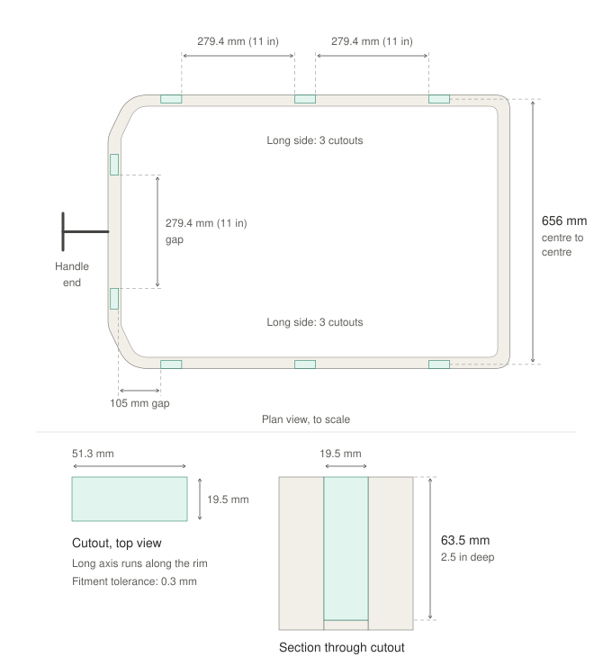

# Cart cutout dimensions

[← All accessories](../README.md)

Measured facts about the cutouts in the top rim of the [Gorilla Cart 200L Poly Dump Cart](https://gorillacarts.com.au/collections/poly-carts/products/gcg7-au) body. All accessories are designed against these.

The long axis of each cutout runs along the rim.

| Fact | Value |
| --- | --- |
| Cutout shape | Rectangle |
| Cutout size | 51.3 × 19.5 mm |
| Cutout depth | 63.5 mm (2.5 in) |
| Fitment tolerance | 0.3 mm in total per dimension (0.15 mm per side), so a plug is 51.0 × 19.2 mm |
| Cutouts per long side | 3 on each long side (6 total) |
| Cutouts on short side nearest the handle | 2 |
| Total cutouts | 8 |
| Gap between adjacent cutouts along a side | 11 in (279.4 mm) edge to edge, so 330.7 mm centre to centre |
| Width across the cart (short side) | 656 mm, centre to centre between cutouts on opposite long sides |
| Gap between the handle-end cutouts | 11 in (279.4 mm) edge to edge, the same as along the sides |
| Handle-end cutouts along the cart | 105 mm clear gap, edge to edge, to the nearest long-side cutouts: 140.4 mm centre to centre |
| Rim corners at the handle end | A round, a flat about 64.5° from the long side, and a second round |

These facts live in code in [src/cart.ts](../src/cart.ts), which every accessory imports.

## The key

Every accessory is built on the same key: a 19.2 × 51.0 mm bar with 1 mm 45° chamfers on its four upright edges, whose bottom 63.5 mm drops into a cutout ([src/key.ts](../src/key.ts)). The accessory is whatever stands above the rim.
