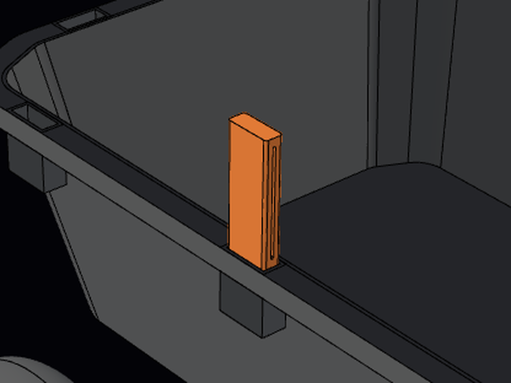

# Machete sleeve

[← All accessories](../README.md)

Carries a machete on the rim. A bar drops into a cutout and stands up above the rim. A 3 mm slot runs right through the upper part, open on both narrow faces, for the machete blade to pass through.

## What to print

One sleeve. Source: [src/machete-sleeve.brep.ts](../src/machete-sleeve.brep.ts).

## Dimensions

| | |
|---|---|
| Bar | 19.2 (X) × 51.0 (Y) × 193.2 (Z) mm, the cutout section less the fit tolerance |
| Corners | 3 mm fillet on the four upright edges; top and bottom faces flat |
| Insert | Bottom 63.5 mm sits in the cutout |
| Slot | 3 mm wide stadium, 110 mm between end centres (113 mm overall), through along Y |
| Slot position | Centred in X/Y and in the 129.7 mm above the rim: z 71.85 to 185.05 |
| Walls | 8.1 mm either side of the slot, 8.35 mm of solid above and below it |

## Design notes

The overall height is 63.5 + 110 + 20 − 0.3. The 0.3 mm fit tolerance is also taken off the height, as in the original design, although no fit depends on it there.
