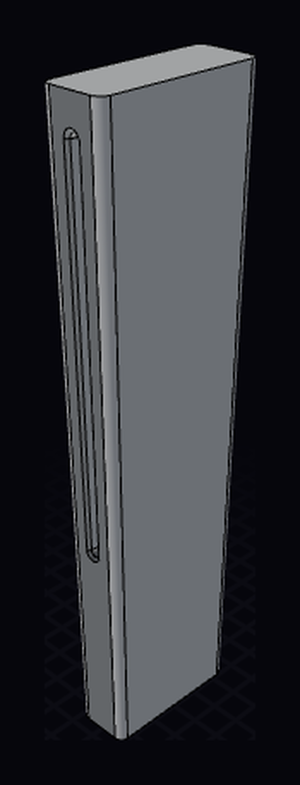

# Machete sleeve

[← All accessories](../README.md)

Carries a machete on the rim. A bar drops into a cutout and stands up above the rim. A slot runs right through the upper part along the rim, open on both narrow faces, for the machete blade to pass through.

## What to print

One sleeve. Source: [src/machete-sleeve.brep.ts](../src/machete-sleeve.brep.ts).

For a different blade, change `bladeThickness`: the slot adds the fit tolerance. For a wider blade, change `slotSpan`, and `standHeight` with it to keep the walls above and below the slot.

## Printing

Print it standing, as it sits in the cart, on the bottom of the key. The top of the slot is the only overhang, a 3.3 mm arch. It is a tall part on a 19.2 mm base, so use a brim.

## Fitting

Drop the key into any cutout. Slide the blade through the slot along the rim, cutting edge down. Friction holds it in place. The chamfered slot mouths guide the blade in from either end.

## Dimensions

| | |
|---|---|
| Insert | 19.2 × 51.0 mm key, bottom 63.5 mm into the cutout |
| Bar | Same section, 130 mm above the rim |
| Slot | 3.3 mm wide stadium (3 mm blade + 0.3 mm fit tolerance), 110 mm between end centres (113.3 mm overall), through along Y |
| Slot position | Centred in X/Y and in the 130 mm above the rim: z 71.85 to 185.15 |
| Walls | 7.95 mm either side of the slot, 8.35 mm of solid above and below it |
| Edges | 1 mm chamfer round both slot mouths |
| Overall | 19.2 (X) × 51.0 (Y) × 193.5 (Z) mm; top 130 mm above the rim |
