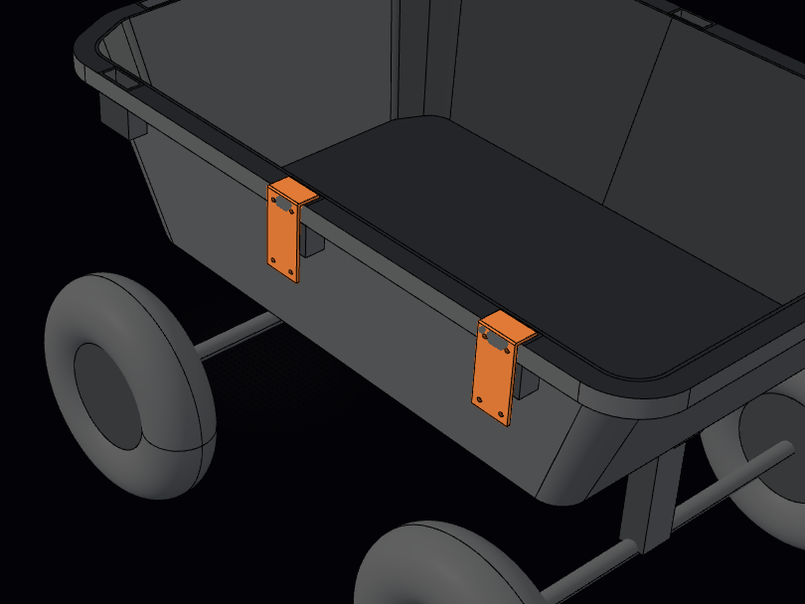
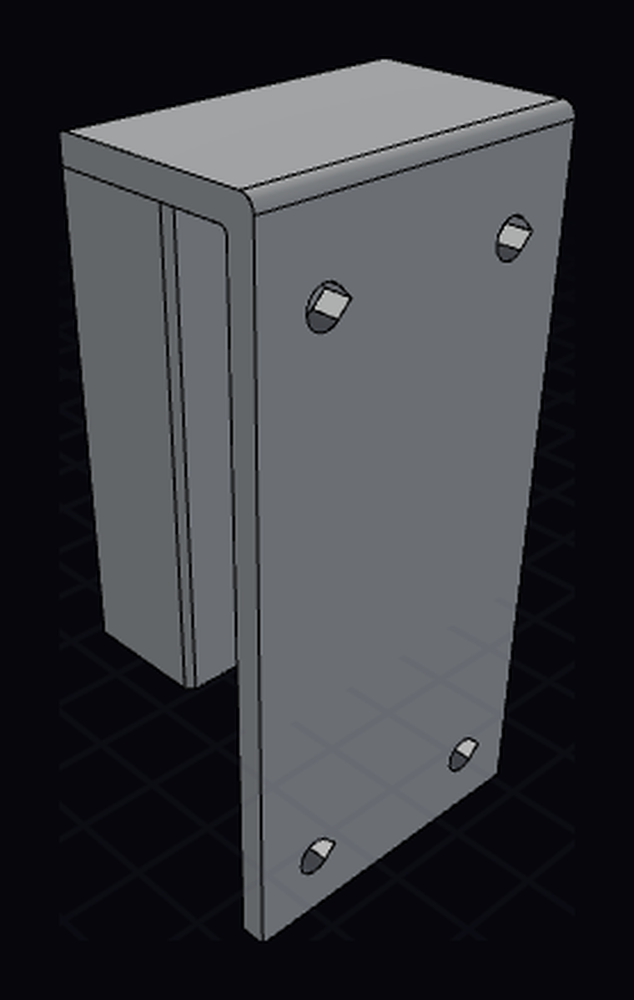

# Mounting plate

[← All accessories](../README.md)

A flat plate that hangs outside the cart, to bolt or screw a sheet of ply, or anything else, to. The key drops into a cutout. A bridge runs from its top out over the rim, and the plate hangs down from the bridge's outer end, 5 mm clear of the rim. Four M5 holes through the plate take the bolts or screws. Leave the plate off, and it's a bracket on the rim instead, with two holes down through its top.

## What to print

One plate per cutout. To carry a sheet, fit two or more in neighbouring cutouts along a side, 330.7 mm apart centre to centre. Source: [src/mounting-plate.brep.ts](../src/mounting-plate.brep.ts).

The [STL generator](https://macropin.github.io/gorillacart/#mounting-plate) changes:

- whether it has the plate at all
- the plate's drop, thickness and gap to the rim
- the bridge's thickness
- the holes: 2 or 3 columns, 2 to 5 rows, and their diameter, for M3 to M6
- holes in the top, with a gap of 14 mm or more
- a registration boss and bolt holes on the plate, so an accessory can bolt to it as to a post

## Printing

Print it lying on one end, with the hook's profile flat on the bed. The key, bridge and plate then all rise straight up, and nothing needs support. The holes are teardrops pointing along the rim: put the end their points face away from on the bed, so the points face up. A registration boss on the plate has 45° sides, so it needs no support either.

Printed this way, every layer is a whole hook, so the plate's load bends the part within its layers rather than across them. Printed standing, it would pull its layers apart where the plate meets the bridge. For heavy loads, print it in PETG with enough walls to make the plate solid: five at a 0.4 mm line width.

## Fitting

Push the bolts through the plate from behind before you drop the key into a cutout, with the plate outside the cart. The 5 mm gap between the plate and the rim takes a low head, such as a button or pan head, but not a nut. Hang the sheet on the bolts and tighten the nuts on its outside face.

To put the nuts behind the plate instead, widen the gap in the generator: 10 mm takes an M5 nut, washer and the bolt's end. From 14 mm, the generator can also put holes down through the top of the bridge, over the gap, one above each column of the plate's holes. Bolt down through them with a nut and washer underneath: there's room under the bridge for an M5 nut to turn, between the rim's edge and the round in the corner under the bridge.

Without the plate, the part is the key and the bridge alone, reaching 18 mm past the rim's outside edge, its end rounded underneath, with the two holes in its top. Bolt down through them, with the nuts underneath, outside the rim.

### Bolting an accessory to it

Turn on the registration boss and bolt holes in the generator. The plate's outside face then carries a side extension post's [stacking features](side-extension-kit.md#stacking-accessories), and the bladed tool holder, tool battery holder or tie-down block bolts to it as to a post. Push M5 bolts through from behind the plate, their heads in the gap, then press the accessory's key onto them and onto the plate, its pocket over the boss and its counterbores facing out. The nuts go in the counterbores. Use M5 × 25 for one accessory, or M5 × 45 for two, with a [stack locator](side-extension-kit.md#stack-locator) between them. The bolts' ends stand a couple of millimetres proud of the counterbores. With a gap of 10 mm or more, the bolts can go the other way round, heads in the counterbores and nuts behind the plate.

The boss is centred down the plate's drop, so the accessory's key sits on the plate and the rest of it stands up past the rim, outside the cart. The boss stops a sheet sitting flat on the plate, which is why both are off unless asked for. With three columns of holes, the middle column leaves out the holes that would land on the boss.

Like the other accessories, it's held in by its key alone, and lifts out again. Its load hangs outside the rim, so the key levers against the cutout's walls. It hasn't been load-tested: build up to heavy loads gradually.

The rim's outside edge comes from Gorilla's product photos rather than a measurement. If the plate or the bolt heads behind it touch the rim, widen the gap in the generator.

It doesn't stack: with the side extension kit fitted, every cutout holds a post. On the handle end, check that the plate clears the handle and its frame.

## Dimensions

| | |
|---|---|
| Insert | 19.2 × 51.0 mm key, bottom 63.5 mm into the cutout |
| Bridge | 4 mm thick on the rim, from the key's inside face out to the plate's outside face: 32.6 mm across the rim. Top corners rounded at 2 mm. On the inside face, the key's 1 mm chamfers carry on up the bridge's corners to the top |
| Plate | 4 mm thick and 51.0 mm along the rim, the key's length. It hangs 100 mm below the top of the rim, 36.5 mm below the bottom of the key |
| Gap | 5 mm between the rim's outside edge and the plate's inside face. That face is 19 mm out from the cutout's centre line. The inside corner under the bridge is rounded at 1 mm, or 4 mm with a gap of 7 mm or more |
| Holes | Four Ø5.5 mm through the plate, for M5, in two columns and two rows. Columns 31 mm apart, 10 mm in from each end. Rows 80 mm apart: the top one 10 mm below the top of the rim, the bottom one 10 mm above the plate's bottom edge. Teardrops, pointing along the rim |
| Registration boss and bolt holes | Optional, off by default. As on a side extension post: a boss 18 × 52 mm at the plate's outside face, standing 3 mm proud with 45° sides, centred down the drop, 50 mm below the top of the rim. Two Ø5.5 mm bolt holes through boss and plate, 30 mm apart, 35 and 65 mm below the top of the rim. No nut pockets: the plate is too thin |
| Top holes | With a gap of 14 mm or more, or without the plate. Two Ø5.5 mm down through the bridge, in line with the plate's columns, centred over the room under the bridge, 5 mm past the rim's outside edge. Teardrops, pointing along the rim |
| Overall | 32.6 (X) × 51.0 (Y) × 104 (Z) mm; bridge top 4 mm above the rim |
