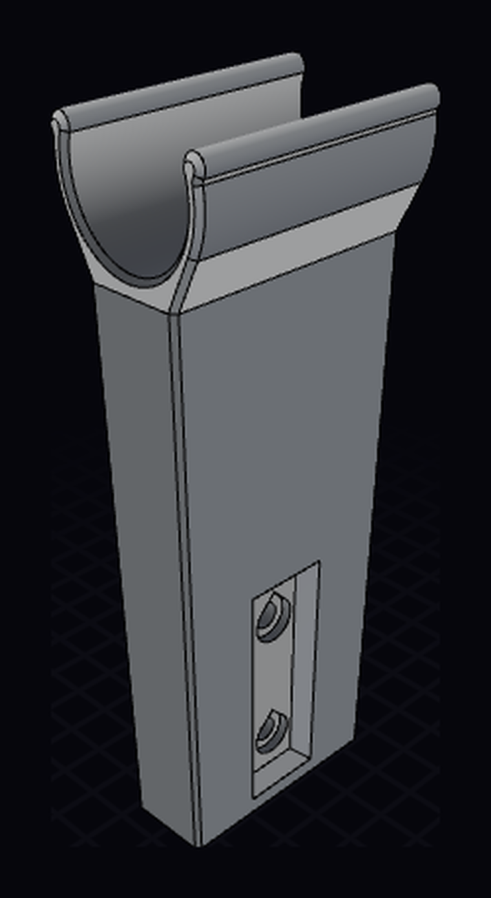

# Pole tool holder

[← All accessories](../README.md)

Carries a long-handled tool along the rim. The key has a clip on its top face, for a 25.3 mm tool pole. The pole lies along the rim and snaps in through an opening narrower than the pole.

The clip comes in two forms:

- **Compliant**, the default and the one in the render above: two hooks wrap the pole, each hanging from a rounded head that's carried on a pair of thin curved spring bands. The bands flex and let the heads swing well clear, so the snap can be deep and the pole is held securely. It's made for PETG. See [Compliant clip](#compliant-clip).
- **Rigid**: a compact U-shaped clip with a shallow snap, which springs open as a whole to let the pole in. Its lips are [rolled over](#rolled-leading-edge) into a round for the pole to roll in over, or can be left [flat](#flat-lip). See [Rigid clip](#rigid-clip).

## What to print

Two holders per pole, both with the same clip. Source: [src/pole-holder.brep.ts](../src/pole-holder.brep.ts), with the compliant clip's shape in [src/compliant-clip.ts](../src/compliant-clip.ts). `make export` writes the compliant holder to `out/pole-holder/` and the rigid one to `out/pole-holder-rigid/` ([src/pole-holder-rigid.brep.ts](../src/pole-holder-rigid.brep.ts)).

The key has the same two bolt holes and registration pockets as the other accessories, so with the side extension kit fitted the holder can [bolt to a post](#bolting-it-to-a-post) instead. Fitted in a cutout as usual, both are hidden in the cutout. Set `boltHoles` or `registration` to 0 to leave either off.

For a different pole, change `poleDiameter`. For a taller or shorter stand, change `standHeight`: the clip always sits on the bar's top face. For the rigid clip, set `clip` to 0, and for its flat lip, `rolledEdge` to 0 as well. The [STL generator](https://macropin.github.io/brepjs-gorillacart/#pole-holder) changes all of these in your browser, along with the compliant clip's snap and spring bands and the size of the [rigid clip](https://macropin.github.io/brepjs-gorillacart/#pole-holder?clip=0)'s rolls.

## Printing

**Compliant clip:** print it lying on one end face, with the clip's profile flat on the bed. Every face then rises straight up from the bed, so nothing needs support. More importantly, the spring bands bend along the layers rather than across them. Standing, the layer lines would cross the bands where they run upright, and the bands could split along a layer. Print it in PETG, which takes the bending far better than PLA. Lying down, the bolt holes and counterbores run level, with their teardrop points to one side, and the registration pockets' 45° sides face up and down. At these sizes they print without support either way.

**Rigid clip:** print it standing, as it sits in the cart, on the bottom of the key. The clip's side lines flare out at about 27° from vertical, and the bore prints as an open-topped channel, so neither needs support. Where the clip's square bottom corners sit over the bar's chamfered corners they overhang by a 1 × 1 mm triangle, which prints as a small ledge. The underside of each roll overhangs outward where it stands proud of the clip's outside. At the default 1 mm bulge it's at most about 34° from vertical, over a band 0.35 mm wide, and it stays within 45° up to a 1.5 mm bulge, so it prints without support. At a 2 mm bulge it reaches about 52°, still under a millimetre wide.

## Fitting

Fit two holders in neighbouring cutouts on the same side, 330.7 mm apart, with their clips in line along the rim. Press the pole down into both clips until it snaps in.

### Bolting it to a post

With the side extension kit fitted, bolt the key to the outside of a post through the two holes in it, as for the other [stacking accessories](side-extension-kit.md#stacking-accessories): two M5 × 30 cap screws into the post's nuts, the key's inside pocket over the post's boss. Fit two holders on neighbouring posts on the same side, so the pole runs along the top of the raised walls.

The clip is wider than the key, so bolted flat to a post it overhangs the post's outside face. It has to sit above the post's top to clear it. A bolted-on key starts 5 mm up the post, so the clip clears the top once `standHeight` is at least the post's extension less 68.5 mm:

| Extension | Least stand height | Suggested |
|---|---|---|
| 150 mm, the kit's default | 81.5 mm | 85 mm, 3.5 mm clear of the post's top |
| Any | Extension − 68.5 mm | A few mm more |

The default 50 mm stand is for a cutout, so for a post, print a pair with the stand raised. Both clips overhang the key on both faces, so bolt the holder on outermost, with nothing outside it. To bolt it outside another accessory instead, its clip has to clear that accessory's top in the same way.

## Compliant clip

Seen end on, the clip is a set of rings round the pole's centre. From the inside out, each side has a hook, a gap, an inner band, a slot and an outer band. Near the top, a rounded head joins them all. The outer band runs over the top of the head, and the inner band wraps round the end of the gap, and they meet at the root of the hook. Below the head, the hook hangs free.

Pushing the pole down between the heads presses them apart. The bands bend along their whole length, and the head and hook swing outward together. Once the pole is past, the bands spring back and the hooks close round it. Because the bending is shared out along two long bands instead of gathered at one hinge, the clip can spring much further than the rigid U for the same strain in the plastic.

| | |
|---|---|
| Insert | 19.2 × 51.0 mm key, bottom 63.5 mm into the cutout |
| Bar | Same section, 50 mm above the rim |
| Bolt holes | Two Ø5.5 mm through the key across the rim, on its centreline, 15 and 45 mm above its bottom. A Ø9.5 × 5.5 mm counterbore on one face for the cap heads. Teardrops, pointing up |
| Registration pockets | One in each broad face of the key, around the bolt holes: 18.3 × 52.3 mm at the face, 3.3 mm deep with 45° sides, centred 30 mm above the bottom of the key. The inside one drops over a post's boss, or either takes a [stack locator](side-extension-kit.md#stack-locator) |
| Clip profile | Rings round the pole's centre, extruded 51 mm along Y. Below them, the convex hull of the bar's top edge and the outer ring |
| Pole centre | 28.8 mm above the bar top (z = 142.3): the outer ring sits on the bar |
| Bore | 25.6 mm (25.3 + 0.3), the hooks' inner face |
| Hooks | 4 mm thick (radius 12.8–16.8 mm), from the heads down to 150° round from the top of the bore, ending in a round tip |
| Gap | 5 mm between each hook and its inner band (radius 16.8–21.8 mm), so the hook can swing out. It runs on round the bottom of the bore, under the pole |
| Bands | Two 2 mm bands either side (radius 21.8–23.8 and 26.8–28.8 mm), from the head at 60.8° from the top down to 143.1°, where the hull's side line meets the outer ring. Along their centre lines, the inner band is 32.8 mm long and the outer band 40.0 mm |
| Slot | 3 mm between the bands (radius 23.8–26.8 mm), closed at both ends. At the bottom it ends in a round; at the top it curls over the gap's end inside the head, to a 1 mm round |
| Heads | 16 mm discs spanning all the rings, centred 20.8 mm from the pole's centre at 60.8° either side of the top, at (±18.15, 38.96) above the bar. Every wall inside them is a band thick |
| Opening | 20.3 mm between the heads, 5 mm narrower than the pole: each head swings out 2.5 mm to let it pass |
| Base | 7 mm under the bore, widening along the hull's side lines (36.9° from the bar's top face) to the bar's top corners |
| Edges | 1 mm chamfer round the clip's outline on both end faces, but not the slots, so each band keeps at least half its thickness at the ends. The chamfer is never more than half a band |
| Overall | 57.6 (X) × 51.0 (Y) × 160.5 (Z) mm; top 97.0 mm above the rim |

The snap and the band thickness can be changed. The opening follows the snap: the heads are placed so the gap between them is `snap` narrower than the pole, and a deeper snap moves them higher round the bore. Thicker bands are stiffer. Their stiffness goes roughly as the cube of their thickness, so 2.5 mm bands take nearly twice the force of 2 mm ones.

## Rigid clip

A U round the pole, its side profile the convex hull of the bar's top edge and a circle round the bore. Its lips stop a little above the pole's centre, so the opening is narrower than the pole, and the whole U springs open to let it in. Set `clip` to 0, or pick **Rigid** in the generator.

### Rolled leading edge

Each lip rolls over into a round: a cylinder along the lip's edge, the length of the clip. The pole meets a round as it goes in, rather than the lip's corner, and the roll stiffens the lip. It's on by default. Set `rolledEdge` to 0, or switch off **Rolled leading edge** in the generator, for the [flat lip](#flat-lip).

The roll starts at the mouth, where the bore ends, at the snap lip height. It's tangent to the bore there, so the bore runs smoothly over into it, with its centre out along the radius through that point. Its diameter is the wall plus `rollBulge`, so it stands that far proud of the clip's outside, measured from the pole's centre, and a 1 mm round blends it into the outside below the mouth. At no bulge the roll is as thick as the wall and tangent to the outside too, and the lip just ends in a half-round.

| | |
|---|---|
| Insert and bar | As the compliant clip: 19.2 × 51.0 mm key, 50 mm above the rim, with the same bolt holes and registration pockets |
| Clip profile | Convex hull of the bar's top edge and a 31.6 mm circle round the bore, ending at each lip in a roll; extruded 51 mm along Y |
| Side lines | From the bar's top corners (±9.6) to tangent points at (±14.02, 8.52) above the bar |
| Bore | 25.6 mm (25.3 + 0.3) along Y, centre 15.8 mm above the bar top (z = 129.3) |
| Wall | 3 mm around the bore and under it |
| Mouth | Where the bore runs into the roll, 4 mm above the bore's centre: at (±12.16, 19.8) above the bar |
| Rolls | 4 mm diameter (3 mm wall + 1 mm bulge), along each lip. Centre 14.8 mm from the pole's centre, 18.2° above level, at (±14.06, 20.43) above the bar |
| Outside | Each roll crosses the outer circle 11.7° above level and is blended into it with a 1 mm round |
| Opening | 24.12 mm between the rolls, level with their centres, 1.18 mm narrower than the pole |
| Edges | 1 mm chamfer round the whole profile on both end faces, rolls included: never more than half the roll or a third of the wall. The clip's base is left square where it meets the bar |
| Overall | 32.1 (X) × 51.0 (Y) × 135.9 (Z) mm; top 72.4 mm above the rim |

A roll big enough to reach down past where the side line leaves the outer circle won't build, and the generator says so. That only happens with a thin wall, a low lip and a large bulge together.

### Flat lip

Without the rolls, the clip's profile is cut flat across the top at the snap lip height, and its lips end in flat tops. The opening is 0.2 mm wider than between the rolls, as the rolls curl the bore a little further over before they turn up. The rest is as above:

| | |
|---|---|
| Clip profile | Convex hull of the bar's top edge and a 31.6 mm circle, cut flat 4 mm above the circle centre; extruded 51 mm along Y |
| Opening | 24.32 mm, 1.28 mm narrower than the bore; 3.13 mm flat lip either side |
| Edges | 1 mm chamfer round the clip's outer profile and the bore mouth, on both end faces; the clip's base is left square where it meets the bar |
| Overall | 31.6 (X) × 51.0 (Y) × 133.3 (Z) mm; top 69.8 mm above the rim |

## Design notes

The compliant clip follows a reference clip, supplied as an STL, for a 16 to 19 mm pole. Sliced across, its profile is concentric rings at radii 8, 12, 17, 19, 22 and 24 mm: the same hook, gap, band, slot and band, at 4, 5, 2, 3 and 2 mm. Its heads are 8 mm discs at 55° from the top, and the hook tips end at 150°. Its slot curls round the gap's end inside the head to a 1 mm round, a band from the gap and a band from the head's outside, as this one does. This clip keeps those thicknesses for any pole and builds the rings out from the bore. It differs in three ways:

- The reference draws each half round its own centre, 1.5 mm either side of the middle, which widens its bore to an oval. Here both halves share the pole's centre, so the hooks fit the pole.
- The reference screws flat to a surface through a 6 mm base, with a flat floor under the bore. Here it stands on the bar, so the base is the hull down to the bar's top face, and the gap runs on round under the pole instead of stopping at a floor.
- The reference's slot hooks inward at its bottom end. Here it stops in a straight round where the hull starts, so the outer band thickens smoothly into the base.

A rough frame model of the bands, with the head and hook taken as rigid, puts the default clip at about 50 N of side force on each head at full spread, with a peak bending strain in the bands of about 1.3%. The head isn't rigid, so the real figures are lower. Either way it's well short of where PETG yields, at roughly 4%. The strain rises with a smaller pole, a deeper snap or thicker bands: at a 16 mm pole, a 6 mm snap and 3 mm bands it's about 3%, and the force about seven times the default. That combination still builds, but it's the one most likely to crack a band.

The compliant clip's outline is drawn as one closed path of exact arcs, with each slot as another. Its declared volume is worked out separately, from the rings, sectors and discs that make it up, so `make verify` checks the outline against that sum.

The rigid clip's rolls aren't cylinders joined on with a boolean. Each roll is tangent to the bore, and OCCT handles tangent faces in booleans badly, so the rolled clip's whole profile, bore included, is drawn as one outline of exact arcs ([src/outline.ts](../src/outline.ts), shared with the compliant clip) and extruded. Where a bulging roll crosses the outer circle it makes a sharp concave crease, which OCCT can't chamfer across. The 1 mm round there makes the outline smooth all the way round, and also keeps strain from gathering at the root of the roll when the lips spring open.

The flat-lipped clip is a plain extrusion, so its four bottom corners are square over the bar's 1 mm chamfered corners. Blending them with a 3 mm fillet doesn't work: OCCT carries it up the outer arc to the top lips.
