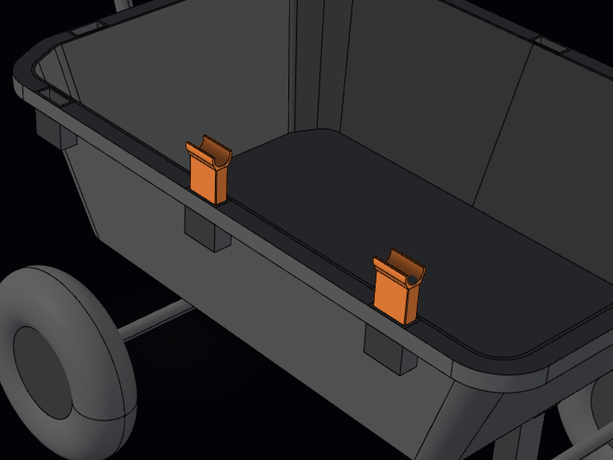
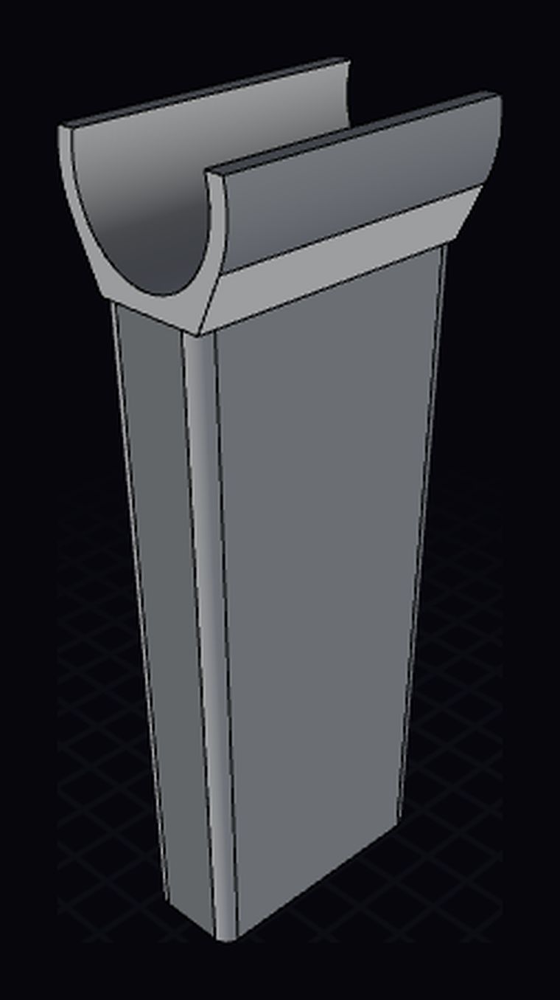

# Pole tool holder

[← All accessories](../README.md)

Carries a long-handled tool along the rim. The key has a U-shaped clip on its top face, for a 25.3 mm tool pole. The pole lies along the rim and snaps in through an opening narrower than the bore.

## What to print

Two holders per pole. Source: [src/pole-holder.brep.ts](../src/pole-holder.brep.ts).

For a different pole, change `poleDiameter`. For a taller or shorter stand, change `standHeight`: the clip always sits on the bar's top face. The [STL generator](https://macropin.github.io/brepjs-gorillacart/#pole-holder) changes both in your browser.

## Printing

Print it standing, as it sits in the cart, on the bottom of the key. The clip's side lines flare out at about 27° from vertical, and the bore prints as an open-topped channel, so neither needs support. Where the clip's square bottom corners sit over the bar's chamfered corners they overhang by a 1 × 1 mm triangle, which prints as a small ledge.

## Fitting

Fit two holders in neighbouring cutouts on the same side, 330.7 mm apart, with their clips in line along the rim. Press the pole down into both clips until it snaps in.

Unlike the other accessories, it can't be [stacked on the side extension kit](side-extension-kit.md#stacking-accessories). The clip is wider than the key, so bolted flat to a post it would hit the post. It has no bolt holes.

## Dimensions

| | |
|---|---|
| Insert | 19.2 × 51.0 mm key, bottom 63.5 mm into the cutout |
| Bar | Same section, 50 mm above the rim |
| Clip profile | Convex hull of the bar's top edge and a 31.6 mm circle, cut flat 4 mm above the circle centre; extruded 51 mm along Y |
| Side lines | From the bar's top corners (±9.6) to tangent points at (±14.02, 8.52) above the bar |
| Bore | 25.6 mm (25.3 + 0.3) along Y, centre 15.8 mm above the bar top (z = 129.3) |
| Wall | 3 mm around the bore and under it |
| Opening | 24.32 mm, 1.28 mm narrower than the bore; 3.13 mm flat lip either side |
| Edges | 1 mm chamfer round the clip's outer profile and the bore mouth, on both end faces; the clip's base is left square where it meets the bar |
| Overall | 31.6 (X) × 51.0 (Y) × 133.3 (Z) mm; top 69.8 mm above the rim |

## Design notes

The clip is a plain extrusion, so its four bottom corners are square over the bar's 1 mm chamfered corners. Blending them with a 3 mm fillet doesn't work: OCCT carries it up the outer arc to the top lips.
