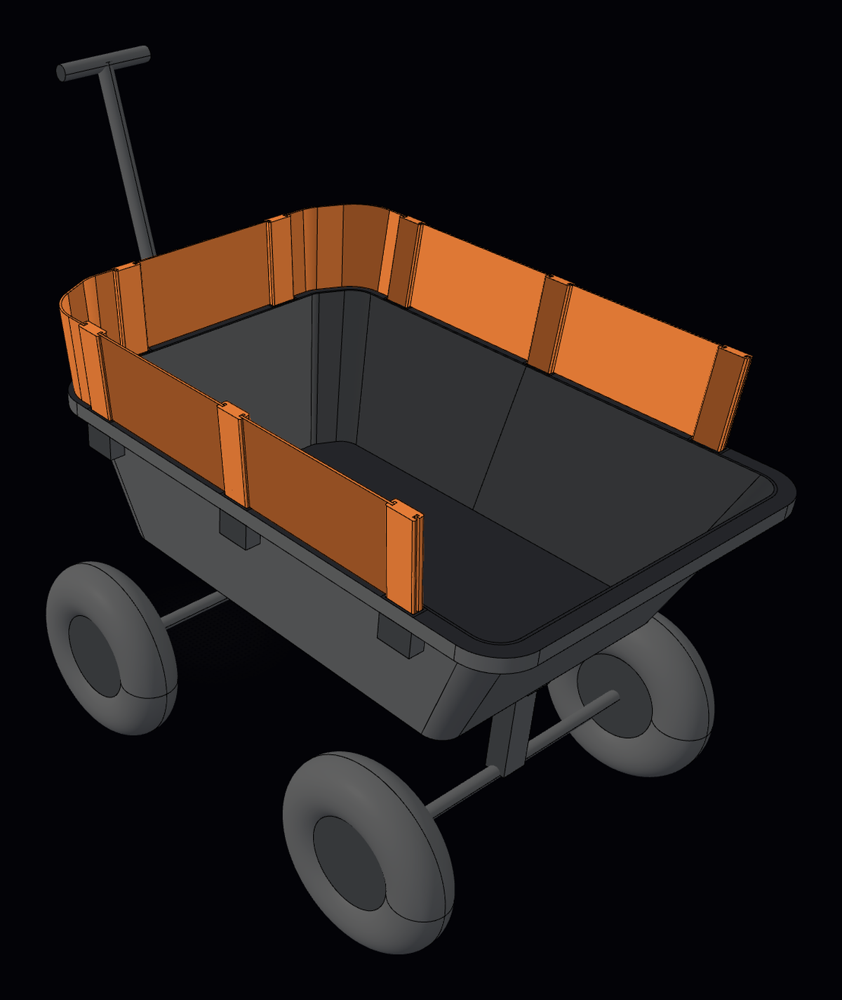
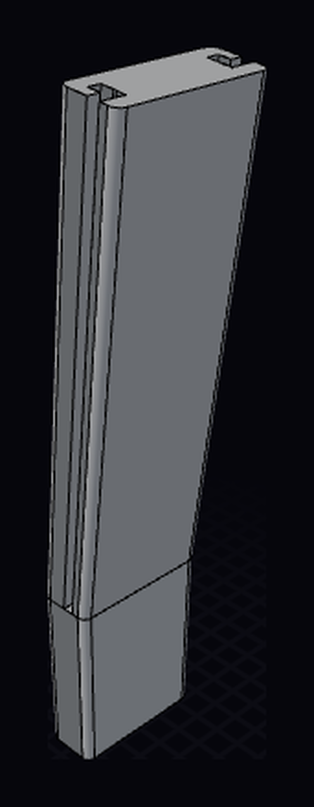
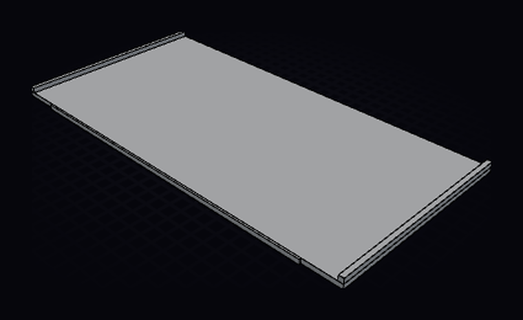
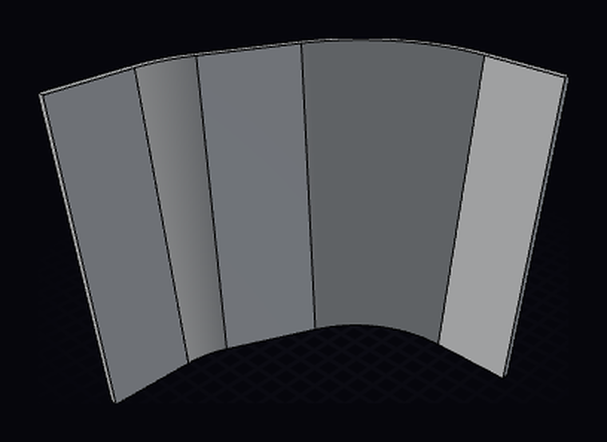

# Side extension kit

[← All accessories](../README.md)

Raises the cart's walls by 150 mm on three sides, adding about 80 litres above the rim and taking the cart from 200 L to about 280 L. The end away from the handle stays open.

The render shows the whole kit in place, in orange. The view looks in over the open far end, toward the handle.

## What to print

| Part | Quantity | Overall size (mm) | Source |
| --- | --- | --- | --- |
| [Post](#posts) | 8, one per cutout | 34.88 × 51.0 × 213.7 | [src/side-extension.brep.ts](../src/side-extension.brep.ts) |
| [Side panel](#side-panels) | 5: two per long side, one across the handle end | 295.4 × 150 × 7.7 | [src/side-panel.brep.ts](../src/side-panel.brep.ts) |
| [Corner panel](#corner-panels), left | 1 | 142.3 × 164.6 × 149.2 | [src/corner-panel-left.brep.ts](../src/corner-panel-left.brep.ts) |
| [Corner panel](#corner-panels), right | 1 | 142.3 × 164.6 × 149.2 | [src/corner-panel-right.brep.ts](../src/corner-panel-right.brep.ts) |

The kit uses all eight cutouts, so it can't be fitted alongside the other accessories.

## Printing

- **Bed size:** the side panel is 295.4 mm long, so it needs a print bed at least 296 mm in one direction. It won't fit a 256 mm bed.
- **Side panels:** print flat on the plain outside face, lips up.
- **Material:** print the panel across the handle end, the one closest to the handle, in PETG or another impact-resistant plastic. The other side panels should be fine in PLA.
- **Corner panels:** print as modelled, standing on the bottom edge. The 6° lean is the only overhang. Use a brim, since it's a tall thin wall.

## Fitting

1. Fit each post with its lean pointing out of the cart. All posts on a side lean the same way, so the panel between two of them lies flat in a plane leaning 6° out. The lip recesses are on the inside wall, so they end up on the cart side once the lean points out.
2. Slide a side panel down into the grooves of each pair of neighbouring posts on the same side: two on each long side and one across the handle end.
3. Fit the corner panels differently. Fit each one into its two posts' grooves first, then lower the posts and the panel into the cutouts together.

The corner panel's legs lean in different directions, so it can't slide straight down into posts that are already fitted: at 6° the ends would have to travel 15.7 mm sideways, almost twice the 8 mm groove depth.

Left and right are as you stand at the handle end facing the tub.

## Capacity

With the far end closed straight across between the two farthest long-side posts, the posts and panels hold about 80 litres above the rim. That's 80.4 L to the panels' inside faces, or 81.2 L to their mid-planes, and takes the cart to about 280 L. At the rim, the panel outline is 801.8 × 656 mm between centre lines. With the 6° lean it grows to about 833 × 687 mm at the top, 149.2 mm higher.

## Posts

Eight identical posts, one per cutout. Each post stands 150 mm above the rim, leaning 6° outward. A groove down each face that points along the rim takes the edge of a side panel. The panel drops in from the top and spans to the next post.

| | |
|---|---|
| Insert | 19.2 × 51.0 mm key, bottom 63.5 mm straight down into the cutout |
| Post | Same section, 150 mm above the rim measured along its axis |
| Lean | 6° outward (toward +X), pivoting about the rim line; trimmed flat where it meets the insert |
| Grooves | 4 mm wide × 8 mm deep on both ±Y faces, open at the top, floor at rim height. Centred 2 mm toward the outside (+X) of the post's axis, so the groove and its lip recess together sit centred in the post |
| Lip recesses | 4 × 4 mm at the bottom of each groove, opening sideways into the inside wall (−X), full height and open at the top. The groove is L-shaped in section |
| Material left | 5.6 mm on both sides at the thinnest: outside the groove and inside the lip recess. 9.6 mm beside the groove on the inside, in front of the recess, as the shoulder that catches the lip. 35 mm core between the groove floors |
| Overall | 34.88 (X) × 51.0 (Y) × 213.7 (Z) mm; top 150.2 mm above the rim |

The insert takes no height off for fit tolerance, unlike the [machete sleeve](machete-sleeve.md).

## Side panels

Flat plates that slide down into the grooves of two neighbouring posts on the same side.

| | |
|---|---|
| Size | 295.4 (length) × 150 (height) × 3.7 (thickness) mm, 7.7 mm at the lips |
| Thickness | 4 mm groove less the 0.3 mm fit tolerance |
| Length | 295.7 mm groove floor to groove floor (330.7 pitch − 2 × 17.5), less 0.3 mm, so 0.15 mm clear at each end |
| Height | Matches the posts, 150 mm above the rim |
| Lips | One at each end on the inside face, full height: 3.7 mm along the panel and standing 4 mm off it. Each drops into its post's lip recess with 0.15 mm clearance all round, so the panel can't pull out of the groove along its length |

## Corner panels

Closes each handle-end corner, from the long-side post nearest the handle to the handle-end post on that side. Between its legs it follows the rim's own corner: a round, a flat and a second round. The handle-end post sits nearer the corner than the long-side post does, so the corner isn't symmetric. The left and right corners take mirror-image parts. The shape both share is in [src/corner-panel.ts](../src/corner-panel.ts).

| | |
|---|---|
| Long-side leg | 122.75 mm from the corner to its end (140.4 − 17.5 − 0.15) |
| Handle-end leg | 145.0 mm from the corner to its end (162.65 − 17.5 − 0.15) |
| Flat | Meets the long-side cutout line 43 mm from the corner and the handle-end line 90 mm from it, about 64.5° to the long side |
| Rounds | 63 mm radius into the long side and 51 mm into the handle end on the cutout lines; 65 and 53 mm on the panel's centreline at the bottom, each growing by 15.7 mm at the top |
| Lean | Legs and flat all lean 6° outward, so the rounds are slices of cones |
| Section | 3.7 mm thick, 150 mm up the slope |
| Ends | Square to their legs and the same length top to bottom; 0.15 mm clear of each groove floor |
| Lips | The side panel's 3.7 × 4 mm lip on the inside face at each leg end |
| Overall | 142.3 × 164.6 × 149.2 mm, printed standing on its bottom edge |

The corner's path is the inside edge of the rim moved 17 mm outward, onto the line through the cutouts. The panel stands 2 mm further out again, in line with the posts' grooves, so its bottom edge sits on the rim all the way round the corner.

## About the render

The cart is a schematic backdrop. Its rim, corners and cutouts are placed from the [cart measurements](cart.md), so the kit sits where it would on the real cart. The tub's slope, the wheels, the frame and the handle are drawn only to look right. [src/assemblies/side-extensions.brep.ts](../src/assemblies/side-extensions.brep.ts) places the kit on the cart from [src/assemblies/cart.brep.ts](../src/assemblies/cart.brep.ts).
