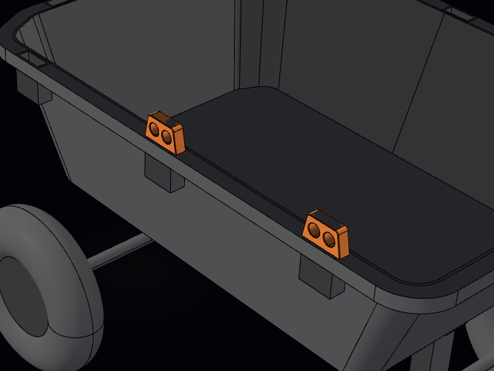
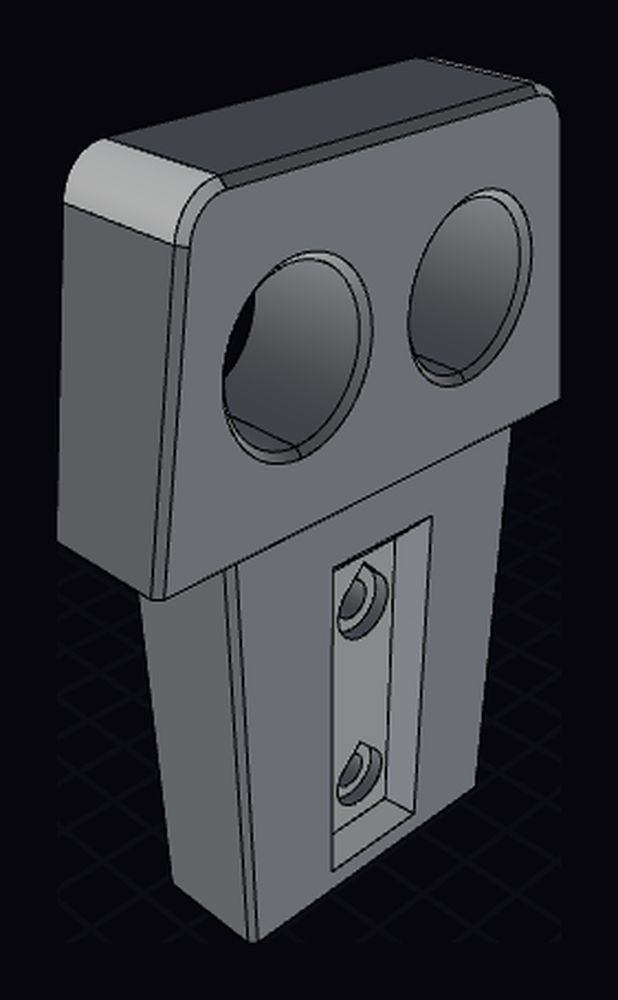

# Tie-down block

[← All accessories](../README.md)

A strap point for holding down an oversize load such as branches. The key drops into a cutout. The head on top rests on the rim either side of the cutout and has two holes through it, across the rim, for a rope or hook. For flat strap webbing, the [STL generator](https://macropin.github.io/gorillacart/#tie-down-block?openings=2) can give it one or two horizontal slits instead.

## What to print

One block per cutout, as many as you need. The render shows two. Source: [src/tie-down-block.brep.ts](../src/tie-down-block.brep.ts).

## Printing

Print it lying on one broad face. Both faces are flat apart from the registration pocket in the key, whose 45° sides close in over the bed, so the holes or slits print upright and nothing needs support. The key's 1 mm chamfered edges rise from the bed at 45°. Lying down, the layers also run the length of the key, which is stronger when a strap pulls sideways on the head.

## Fitting

The block is held in by friction fit alone. Pinning or bolting it would mean drilling the cart, but in use that isn't needed: run the strap through one hole and down to the cart to pull the block into its cutout, and through the other to tie down the load. With slits, pass a strap through one, or weave it through both.

The head is flush with the key across the rim, so it doesn't overhang the rim's inner or outer edge.

With the side extension kit fitted, bolt the key to the outside of a post instead, through the two holes in it, for a strap point above the raised walls. See [Stacking accessories](side-extension-kit.md#stacking-accessories).

## Dimensions

| | |
|---|---|
| Insert | 19.2 × 51.0 mm key, bottom 63.5 mm into the cutout |
| Head | Trapezoid standing on the rim: 72 mm along the rim at the base, 56 mm at the top, 40 mm high; top corners rounded at 6 mm |
| Shoulders | 10.5 mm of the head's base overhangs the cutout at each end and rests on the rim |
| Thickness | 19.2 mm across the rim, flush with the key on both faces |
| Holes | Two Ø20 mm through the head across the rim, 28 mm apart, centred 20 mm above the rim |
| Material around the holes | 8 mm between them, 7.7 mm to each sloping end (measured square to the slope), 10 mm above and 10 mm below to the rim |
| Slits, in place of the holes | One or two through the head across the rim, each a 28 × 6 mm stadium long along the rim, for 25 mm webbing. A single slit is centred 20 mm above the rim; a pair sits either side of that, 8 mm of head between them. Set with `openings` in the source, or in the STL generator |
| Edges | 1 mm chamfer on every edge of both broad faces above the rim, hole and slit mouths included, so straps don't wear on a sharp edge |
| Bolt holes | Two Ø5.5 mm through the key across the rim, on its centreline, 15 and 45 mm above its bottom. A Ø9.5 × 5.5 mm counterbore on one face for the cap heads. Teardrops, pointing up, though printed flat they stand upright |
| Registration pockets | One in each broad face of the key, around the bolt holes: 18.3 × 52.3 mm at the face, 3.3 mm deep with 45° sides, centred 30 mm above the bottom of the key. The inside one drops over a post's boss, or either takes a [stack locator](side-extension-kit.md#stack-locator) |
| Overall | 19.2 (X) × 72 (Y) × 103.5 (Z) mm; head top 40 mm above the rim |
