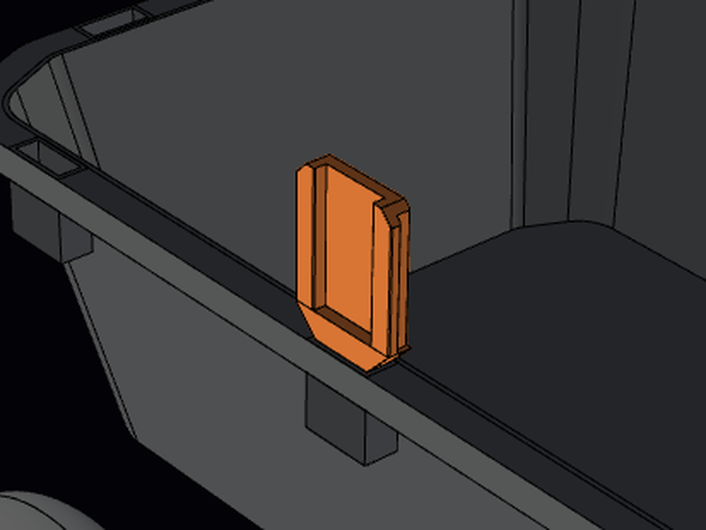
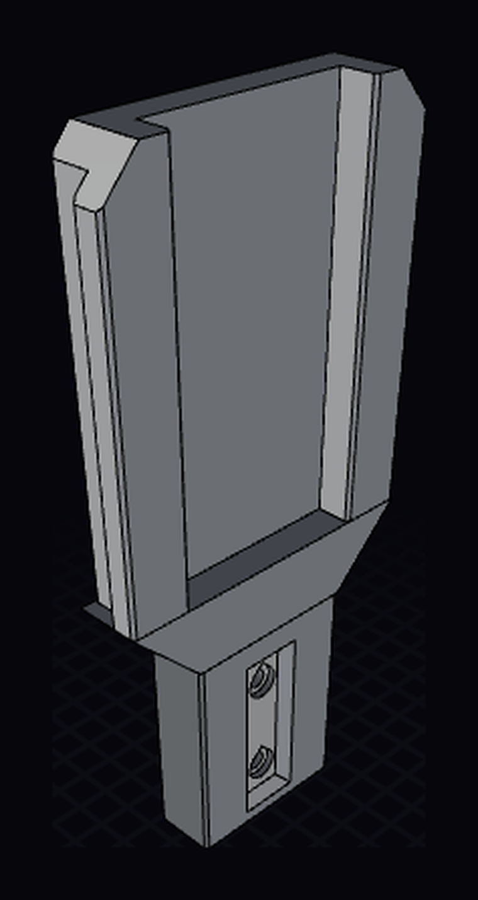

# Tool battery holder

[← All accessories](../README.md)

Carries a power tool battery on the rim. The key drops into a cutout. Above the rim, a base flares out to carry a pair of upright rails with the same T-section as the battery maker's own wall mount. The battery slides down onto the rails from above and hangs there, as it would on a garage wall.

The rails are the battery's interface, so they depend on which battery it carries, set with `batteryType`. So far there's one type, the EGO POWER+ 56V, and the holder is ready for more: see [Battery types](#battery-types).

## What to print

One holder per battery. Source: [src/tool-battery-holder.brep.ts](../src/tool-battery-holder.brep.ts). Pick the battery with `batteryType`, or **Battery** in the [STL generator](https://macropin.github.io/brepjs-gorillacart/#tool-battery-holder).

If the battery is tight or loose on the rails, change `flangeWidth` and `flangeThickness` in its entry in `RAILS`, which set how far the rails reach into the battery's channel. To stand the rails taller or shorter, change `railLength` there.

## Printing

Print it standing, as it sits in the cart, on the bottom of the key. The flanges and the clearance behind them run straight up. The base flares at 45°, the lead-ins at the top are 45°, the bolt holes in the key are teardrops pointing up, and the registration pockets in the key have 45° sides, so nothing needs support. Where the base's square bottom corners sit over the key's chamfered corners, they overhang by a 1 × 1 mm triangle, which prints as a small ledge. It is a tall part on a 19.2 mm base, so use a brim.

Standing, the layers run across the part. The joint at the rim is the most heavily loaded section, and it is the key's full 19.2 × 51 mm, because the recess and the clearance behind the flanges stop at the top of the base.

## Fitting

1. Drop the key into any cutout. Point the rails out of the cart to hang the battery outside the rim, or into the cart to keep it inside.
2. Hold the battery with its rail channel toward the holder and the open end of the channel down.
3. Line the channel up over the top of the rails and slide the battery down until it stops. The lead-ins guide the channel on.

To take the battery off, lift it straight up.

Like the wall mounts it follows, the holder keeps the battery on by gravity alone. On rough ground, run a strap over the handle.

The first time you fit it, check that the bottom of the battery clears the rim. See [Where the battery hangs](#where-the-battery-hangs).

With the side extension kit fitted, bolt the key to the outside of a post instead, rails out, through the two holes in it. It goes outermost in a stack. See [Stacking accessories](side-extension-kit.md#stacking-accessories).

## Dimensions

For the EGO 56V, the only battery type so far:

| | |
|---|---|
| Battery | EGO POWER+ 56V, `batteryType` 0 |
| Insert | 19.2 × 51.0 mm key, bottom 63.5 mm into the cutout |
| Base | Flares at 45° along the rim, from the key's 51 mm at the rim to 92 mm, 20.5 mm higher. 19.2 mm across the rim, flush with the key. Solid |
| Rails | T-section, 102.5 mm tall above the base. 92 mm across the flange tips, flanges 8 mm thick, 83 mm across the neck behind them |
| Lip clearance | Each flange overhangs the neck by 4.5 mm. Behind it, 11.2 mm of clear depth for the battery's lips, open at the back |
| Recess | 56 mm wide down the middle of the rails' front face, 10 mm deep below the battery face, running the full length of the rails |
| Battery face | The flanges' front faces, flush with the key's face |
| Lead-in | 45° on each rail's top corner, taking the rails from 92 mm across down to 72 mm at the top face |
| Edges | 1 mm chamfer up the section's outside corners: flange tips, recess edges and back corners |
| Bolt holes | Two Ø5.5 mm through the key across the rim, on its centreline, 15 and 45 mm above its bottom. Teardrops, pointing up. A Ø9.5 × 5.5 mm counterbore on the rails' side for the cap heads |
| Registration pockets | One in each broad face of the key, around the bolt holes: 18.3 × 52.3 mm at the face, 3.3 mm deep with 45° sides, centred 30 mm above the bottom of the key. The inside one drops over a post's boss, or either takes a [stack locator](side-extension-kit.md#stack-locator) |
| Overall | 19.2 (X) × 92 (Y) × 186.5 (Z) mm; top 123 mm above the rim |

## Battery types

| `batteryType` | Battery | Rails |
| --- | --- | --- |
| 0 | EGO POWER+ 56V | 92 mm across the flange tips, 8 mm flanges, 83 mm neck, 56 × 10 mm recess, 102.5 mm long: see [EGO 56V rail section](#ego-56v-rail-section) |

Each type's rail section and length is an entry in `RAILS` in [src/tool-battery-holder.brep.ts](../src/tool-battery-holder.brep.ts), keyed by its number in `BATTERY_TYPES`. The key, base and stacking features are the same for every type; the base flares out to whatever the rails are across.

To add a battery type:

1. Give it the next number in `BATTERY_TYPES`.
2. Add its rails to `RAILS`, with the label the generator shows: the flange width and thickness, the neck width behind the flanges, the recess down the middle of the face, the rail length and the lead-in at the top. Measure them from the maker's own wall mount, or from a published one, as the EGO numbers were.
3. Run `make sweep PART=tool-battery-holder`, which builds every type. The generator offers it as soon as it's in `RAILS`.

The section assumes the same T-rail shape as EGO's, flanges with lip clearance behind them and a recess down the middle. A battery that mounts another way would need its own section drawn in `design`.

## Design notes

### EGO 56V rail section

EGO's spec sheets give the pack's outside size but not its rail interface. The packs are 195 mm long and 148 to 159 mm wide, and 82 to 105 mm deep depending on capacity. The rail section is measured instead from the STLs of three published wall mounts. The first two agree to the millimetre, and this holder takes their numbers.

| | Ego_Battery_Holder ([Printables 81326](https://www.printables.com/model/81326-ego-battery-holder)) | ego battery support with angle | 56v_Battery_Holder_v2 | This holder |
| --- | --- | --- | --- | --- |
| Across the flange tips | 92 | 92 | 93 | 92 |
| Flange thickness | 8 | 8 | 9 | 8 |
| Across the neck | 83 | 83 | 80 | 83 |
| Clear depth behind the flanges | 9, then a back plate | Open to the wall | 11, then a base flange | 11.2, open |
| Centre recess | 56 wide, 10 deep | 56 wide, 10 deep | 68 wide, 6.3 deep | 56 wide, 10 deep |
| Rail length | 102.5 | 67.7, tilted about 6° off the wall | 30 | 102.5 |
| Top of the rails | 10 mm 45° lead-in | 10 mm 45° lead-in | 2 mm rounds | 10 mm 45° lead-in |

All three hold the battery the same way. The pack slides down onto upright rails and hangs from them, with no latch catch.

### Where the battery hangs

How low the battery hangs depends on how far its channel runs, which none of the references show. The rails are 102.5 mm long, as on the 81326 holder. If the channel is about that long, the bottom of the battery ends up about level with the bottom of the rails, 20.5 mm above the rim. If it's longer, the lips land on the top of the base, at the same height.

The battery face is flush with the key's face, inside the rim's outer edge. So the battery has to stay above the rim; it can't hang down past it. If yours doesn't clear the rim, lengthen the rails with `railLength` in the EGO entry in `RAILS`.
